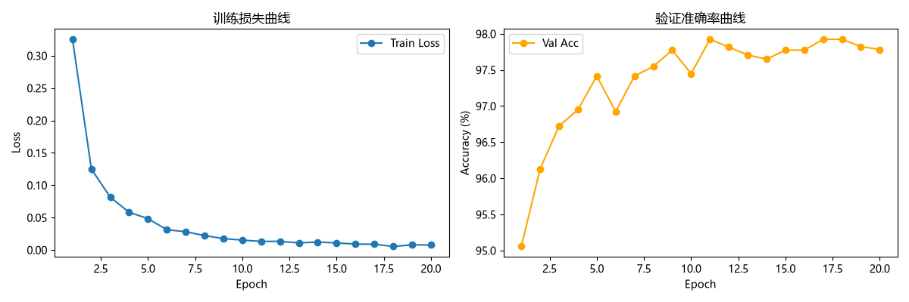
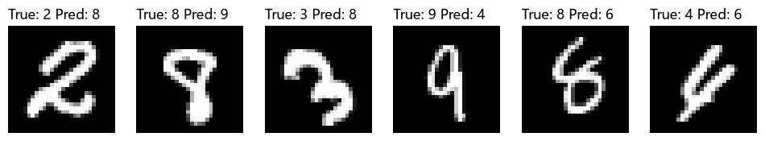

# 深度理解多层感知机（MLP）：从原理到 MNIST 手写数字识别实战

> 本文先梳理 MLP 的基本原理（神经元结构、前向传播、误差反向传播、过拟合与 Dropout、参数初始化），再用 PyTorch 从零完成 MNIST 手写数字识别的拓展任务与调参实验，全部代码与实验数据见文末仓库。

## 一、简介

多层感知机（MLP，Multi-Layer Perceptron）是最经典的深度学习入门模型。本篇博客分两部分：第一部分讲清楚 MLP 的结构、数据如何前馈、误差如何反向传播；第二部分记录我自己用 PyTorch 在 MNIST 数据集上完成手写数字识别拓展任务的全过程——包括不同隐藏层数、不同神经元个数的对比实验，以及把验证准确率从 92% 调到 98% 的调参记录和踩坑总结。

## 二、从生物神经元到感知机

神经网络的灵感来自生物神经元：树突接收信号、轴突输出信号，海量神经元连接协作完成高级思考。人们仿照这个结构，构造了人工神经网络。

神经网络计算的基本单元是**神经元（节点）**。每个节点接收若干输入，每个输入有各自的**权重 w**，表示这个输入对输出影响的大小；此外还有一个**偏置 b**，提供可训练的常量。节点的输出为：

```
Y = f(w1*x1 + w2*x2 + ... + b)
```

其中 f 是**激活函数**，它必须是非线性的——如果激活函数是线性的，无论网络叠多少层，整体仍然等价于一个线性模型，无法解决异或这类非线性问题。常见的激活函数：

| 激活函数 | 输出范围 | 特点 |
| --- | --- | --- |
| Sigmoid | (0, 1) | 常用于二分类输出层，深层易梯度消失 |
| tanh | (-1, 1) | 零中心，收敛快于 Sigmoid |
| ReLU | [0, +∞) | 计算简单、缓解梯度消失，隐藏层默认首选 |

本项目隐藏层全部使用 ReLU。

## 三、MLP 整体结构

MLP 由三部分组成，至少包含一个隐藏层：

1. **输入层**：不做计算，只把信息传给隐藏层。MNIST 任务中输入层节点数为 28×28 = 784。
2. **隐藏层**：与外部无直接联系（因此得名），负责绝大部分计算，可以有一层或多层。
3. **输出层**：输出最终结果。10 分类任务的输出层为 10 个节点。

层数与每层神经元个数（即"网络容量"）直接决定模型能学到多复杂的函数——这也是我后面拓展任务重点实验的变量。

## 四、数据前馈（前向传播）

以一个样本为例，信号从输入层出发，逐层加权求和、过激活函数，最后在输出层得到预测值，这个过程叫前向传播。

对 MNIST：一张 28×28 的手写数字图被展平成 784 维向量输入网络，经过隐藏层逐层变换，输出层给出 10 个类别的得分。训练开始时权重是随机的，输出基本是"瞎猜"（第一个 epoch 准确率只有 78.9%），接下来就要靠误差反向传播来修正权重。

## 五、误差后馈（反向传播）

反向传播（BackProp）的核心思想是"从错误中学习"：

1. **前向传播**算出输出，与真实标签比较，用损失函数（本项目用 `nn.CrossEntropyLoss`）量化误差；
2. **误差反向传播**：利用链式法则，把误差从输出层逐层往回传，算出每个权重对误差的"贡献"（梯度）；
3. **梯度下降**更新权重：`w ← w - lr * ∂L/∂w`，让误差一步步变小；
4. 重复以上过程，直到误差收敛。

几个关键实践细节（我自己踩过的）：

- **CrossEntropyLoss 的输入是原始 Logits**：PyTorch 的 `nn.CrossEntropyLoss` 内部已包含 LogSoftmax，网络最后一层必须是 `Linear(in, 10)`、后面不能再接 Softmax，否则梯度是错的。
- **标签必须是整数类型**：DataLoader 默认 collate 可能产生 float 标签，训练入口加一句 `assert labels.dtype == torch.long` 能避免很多隐性错误。

## 六、过拟合与 Dropout

**过拟合**：训练误差很小但泛化误差大——模型把训练样本里的"噪声"也背下来了。**欠拟合**则相反，训练误差本身就很差。

**Dropout** 是最常用的正则化手段：训练时以概率 p 随机让一部分神经元暂时失效，每次相当于在训练一个不同的子网络，最终效果类似"多个网络取平均"，同时迫使网络不依赖某些特定神经元，学到更鲁棒的特征。

**早停（Early Stopping）**：监控验证集损失，连续若干轮不再下降就停止训练，避免训练过头。本项目实验中模型未出现明显过拟合，因此 Dropout 带来的收益有限（见第八节实验）。

## 七、参数初始化的注意事项

1. **禁止把所有权重初始化为同一个常数**，否则所有神经元对称、梯度完全相同，BP 算法会失效。
2. 一般让权重服从 0 均值的高斯分布，方差要合适：过小导致梯度消失，过大无法收敛。常用 Xavier 初始化 `σ² = 2/(n_in + n_out)` 或 He 初始化 `σ² = 2/n_in`。
3. **固定随机种子**：在 DataLoader、权重初始化、numpy、random 四处统一设置，保证实验可复现——我做对比实验时最开始没固定 seed，同一配置跑两次结果不一样，还以为是代码写错了。

## 八、实战：MNIST 手写数字识别拓展任务

### 8.1 数据与实验设置

- 数据：MNIST 60000 张训练图 + 10000 张测试图，28×28 灰度图。
- 划分：按类别随机打乱后 5 等分，**前 4 份（48004 张）训练，第 5 份（11996 张）验证**。
- 预处理：像素值 /255.0 归一化到 [0,1]，标签为 int64 整数。
- 基线配置：2 个隐藏层 (256, 128)，SGD lr=0.01，10 epochs。

### 8.2 拓展任务实验结果

**任务(3)：不同隐藏层层数对比**（10 epochs, SGD lr=0.01）：

| 层数 | 结构 | 验证准确率 |
| --- | --- | --- |
| 1 层 | (256,) | 92.02% |
| 2 层 | (256, 128) | 92.76% |
| 3 层 | (256, 128, 64) | 92.89% |

层数越深准确率略高，但提升很小——对 MNIST 这种简单任务，2 层已经足够，层数带来的边际收益很低。

**任务(4)：2 个隐藏层、不同神经元个数对比**（10 epochs）：

各组验证准确率均在 90%–92% 区间，神经元数量在小范围内的增减对结果影响同样有限。

### 8.3 调参：从 92% 到 98%

固定 2 隐藏层 (256,128)，每次只动一个参数，共完成 24 组实验，关键结论：

| 改动 | 效果 |
| --- | --- |
| epoch 10 → 20 | 明显提升 |
| SGD → Adam (lr=0.001) | 明显提升 |
| Dropout 0.5 | 无收益（模型未过拟合，强正则反而拖慢收敛） |
| 权重衰减 (Weight Decay) | 无收益 |

**最终最优配置：2 隐藏层 (256,128) + Adam lr=0.001 + 20 epochs，验证准确率 98.01%**（SGD lr=0.05 也能达到 97.46%）。





### 8.4 踩坑记录

1. **环境搭建**：pip 默认源下载 PyTorch 超时，换国内镜像解决；Anaconda 频繁闪退后直接改用 venv。
2. **数据集问题**：MNIST 官方 `.gz` 文件**不需要解压**，直接读取即可，解压反而报错；一开始我以为要手写数字集，实际从网上下载四个 gz 文件放进 raw 文件夹就行。
3. **数据划分理解错误**："5 等分取 4 份训练"是**按比例**切分（48000+12000 那种硬凑整除的改法是错的），跑几次结果不一致后加上 seed 随机种子才稳定。
4. **隐藏层实验设计**：任务(3)是比较"层数"、任务(4)是固定层数比较"神经元个数"，一开始我以为是同一件事，换了个数字就跑，后来才明白完全是两个实验。
5. **调参方法论**：一次只改一个参数，否则无法归因；每组实验固定 seed，保证对比公平。

## 九、总结

- MLP 的三要素：非线性激活函数、误差反向传播、梯度下降，理解了这三点就理解了深度学习训练的基本骨架。
- 对 MNIST 任务，网络容量（层数/宽度）带来的提升有限，**优化器（Adam）和训练轮数**才是性价比最高的调参方向。
- 正则化不是万能的：只有当模型真的过拟合时，Dropout/权重衰减才有意义。
- 固定随机种子 + 单变量调参，是实验可复现、结论可归因的前提。

## 附：仓库导航

| 文件 | 说明 |
| --- | --- |
| `data_loader.py` / `model.py` / `trainer.py` | 数据、模型、训练流程封装 |
| `expand_task.py` | 拓展任务主实验（层数/神经元对比） |
| `tuning.py` | 单变量系统调参实验 |
| `final_model.py` | 最优配置训练最终模型并可视化 |
| `调参记录.md` / `results.json` | 24 组调参完整记录与原始数据 |
| `training_curves.png` / `wrong_predictions.png` | 训练曲线与错误样本可视化 |
